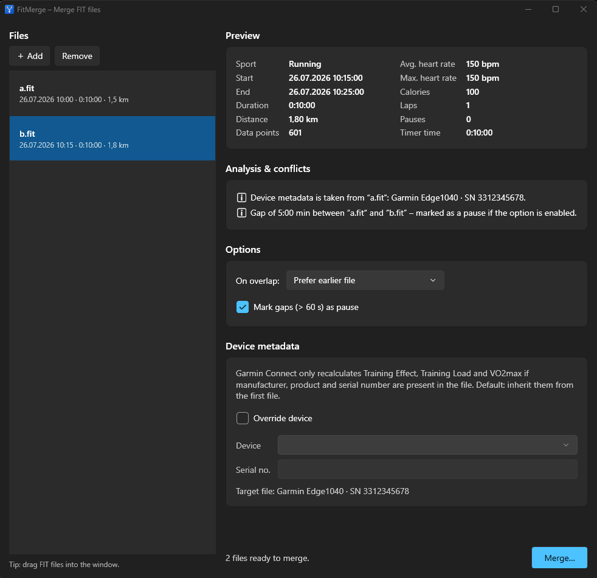
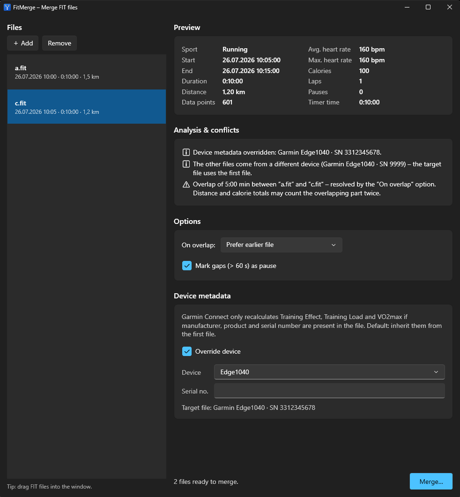

# FitMerge

A small Windows desktop app that merges several `*.fit` activity files into one valid FIT file.
Typical case: a ride that was recorded in two parts because the head unit was stopped and restarted.

  

## Features

- Add any number of FIT files (button or drag and drop) and preview what each one contains.
- **Conflict analysis** before merging, with a choice of how to resolve each case:
  - *Overlapping* recordings: prefer the earlier file, prefer the later file, or keep all data points.
  - *Gaps* between files and *pauses* inside a file: optionally written as timer stop/start events,
    so the timer time excludes them.
  - *Duplicates* (same time span) and *mixed sports* are flagged.
- **Device metadata** (`file_id` and `device_info`) is inherited from the first file, or overridden
  with `--device` / `--serial`. See [Device metadata](#device-metadata).
- The merged file is read back after writing, and the metadata that was actually stored is shown.
- Windows 11 look (built-in WPF Fluent theme, follows the system light/dark mode). English and German UI,
  chosen from the system language.

## Screenshots

A gap between two recordings (the second file is selected, the first file provides the device identity):



Overlapping recordings with a device override:



## Install

Download the zip from the [latest release](../../releases/latest), unpack it and run `FitMerge.exe`.
It needs the [.NET 10 Desktop Runtime](https://dotnet.microsoft.com/download/dotnet/10.0).

## Use

1. Add the files you want to merge. The **first file in the list** decides the device identity of the result.
2. Check the *Analysis & conflicts* card and pick the options you want.
3. Click **Merge…** and choose where to save the result.

Command line (all optional):

```text
FitMerge.exe [--device <name>] [--serial <number>] [--lang <en|de>] [file.fit ...]
```

| Option | Meaning |
|---|---|
| `--device <name>` | Garmin product, e.g. `edge_1040`, `Edge1040`, `fenix_7`, or a numeric product ID. An unknown name shows a list of candidates instead of guessing. |
| `--serial <number>` | Serial number (unit ID) for the target file. Without it, the serial of the first input file is kept. |
| `--lang <en\|de>` | Overrides the UI language. |

## Device metadata

Garmin Connect recalculates Training Effect, Training Load and VO2max on upload only if the file names a
plausible Garmin device. FitMerge therefore writes both `file_id` (type, manufacturer, product, serial number,
time created) and `device_info` (device index 0 = creator, manufacturer, product, serial number,
software version, source type local).

- By default everything is copied from the first input file, including the serial number.
- If the source is not a Garmin device, the real manufacturer is kept and a warning is shown; `--device`
  switches the manufacturer to Garmin explicitly.
- FIT files carry the device's **unit ID**, which is not necessarily the serial number printed on the box.
  Copying it from a real activity file of that device is the reliable way.

## What is sent where

Nothing. FitMerge works on local files only and makes no network connections.

## Limits

- Tested with synthetic FIT files only, not yet with recordings from real devices of many brands.
- Records, laps, events, session and activity messages are merged. Other message types (for example
  developer fields, workouts or sensor-specific data) are not carried over.
- Distance and calorie totals of overlapping recordings can count the overlapping part twice
  unless you resolve the overlap with *prefer earlier/later file*.

## Troubleshooting

| Symptom | Cause |
|---|---|
| "Not a valid FIT file" | The file header check failed; the file is damaged or not a FIT file. |
| "contains no data points" | The file has no `record` messages, e.g. a settings or workout file. |
| Garmin Connect shows no recalculated values | Check the warnings: manufacturer must be Garmin, and product and serial number must be present. |

## Development

Requires the .NET 10 SDK (Windows).

```powershell
dotnet build FitMerge.slnx
dotnet run --project tests/FitMerge.SmokeTests
```

The smoke tests generate synthetic FIT files, run them through reader, merger and writer, and assert on the
files read back. UI strings live in `FitMerge/Resources/Strings.resx` (English) and `Strings.de.resx` (German).
The only dependency is the official [`Garmin.FIT.Sdk`](https://www.nuget.org/packages/Garmin.FIT.Sdk) NuGet package,
which is licensed separately by Garmin.

## License

[MIT](LICENSE)
